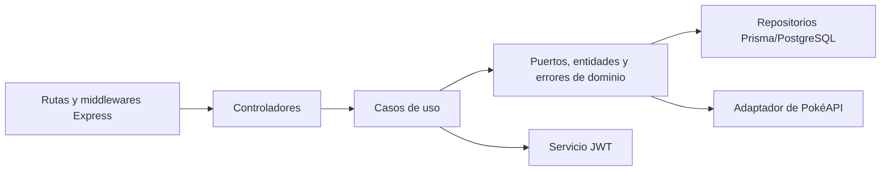

# Backend Chasis Express TS

## Alcance

Este documento describe el comportamiento evidenciado por la implementación actual en TypeScript. El repositorio es un chasis reutilizable para backends Express e incluye flujos de ejemplo de `generic`, usuarios/autenticación, health e integración con Pokémon.

## Ejecución y puntos de entrada

- `src/main.ts` conecta Prisma con PostgreSQL antes de escuchar en `PORT` (por defecto `3000`). Desconecta Prisma durante `SIGINT` y `SIGTERM`, y finaliza con código `1` si falla la conexión inicial a la base de datos.
- `src/server.ts` crea la aplicación Express, habilita el análisis de JSON, la resolución de Awilix por solicitud, Swagger UI en `/docs` y los routers `/chasis/health` y `/chasis/v1`.
- Las rutas desconocidas devuelven `{ "message": "Route not found", "code": 404 }`.

El servidor definido para Swagger es `http://localhost:3000/chasis`; la interfaz se sirve por separado en `/docs`.

## Arquitectura observada

El flujo de dependencias implementado es rutas/controladores HTTP → casos de uso de aplicación → interfaces/entidades/errores de dominio → repositorios/adaptadores de infraestructura. Awilix usa inyección clásica, casos de uso y controladores con ámbito por solicitud, y servicios, adaptadores y repositorios registrados en `src/config/container.ts`.

Las etiquetas arquitectónicas de las guías del repositorio describen DDD/arquitectura hexagonal/Clean Architecture; el diagrama registra las relaciones confirmadas por imports y llamadas.

## Índice de casos de uso de la API

### Health

- [Verificar salud](use-case/health-check.md) — `GET /chasis/health`

### Ejemplos genéricos

- [Consultar generic](use-case/get-generic.md) — `GET /chasis/v1/generic`
- [Crear generic](use-case/create-generic.md) — `POST /chasis/v1/generic`
- [Consultar generic por ID](use-case/get-generic-by-id.md) — `GET /chasis/v1/generic/:id`
- [Consultar Pokémon por nombre](use-case/get-pokemon-by-name.md) — `GET /chasis/v1/generic/pokemon/:name`
- [Actualizar generic](use-case/update-generic.md) — `PATCH /chasis/v1/generic/:id`

### Usuarios

- [Registrar usuario](use-case/register-user.md) — `POST /chasis/v1/users/register`
- [Iniciar sesión](use-case/login-user.md) — `POST /chasis/v1/auth/login`
- [Renovar tokens](use-case/refresh-tokens.md) — `POST /chasis/v1/auth/refresh`
- [Consultar usuario actual](use-case/get-current-user.md) — `GET /chasis/v1/users/me`
- [Listar usuarios](use-case/list-users.md) — `GET /chasis/v1/users`

### Clientes de servicio

- [Autenticación con credenciales de cliente](use-case/client-credentials.md) — `POST /chasis/v1/auth/client-credentials`
- [Crear cliente de servicio](use-case/create-service-client.md) — `POST /chasis/v1/auth/service-clients`
- [Rotar secreto de cliente](use-case/rotate-service-client-secret.md) — `POST /chasis/v1/auth/service-clients/:clientId/rotate-secret`
- [Deshabilitar cliente de servicio](use-case/disable-service-client.md) — `PATCH /chasis/v1/auth/service-clients/:clientId/disable`

## Autenticación y autorización

Los JWT se firman con HS256 usando `JWT_SECRET`, con valores predeterminados de `15m` para tokens de acceso y `30d` para tokens de renovación. `authenticateJWT` requiere `Authorization: Bearer <token>`, verifica el tipo de token y adjunta sus claims a la solicitud. `authorizeScopes` permite la solicitud cuando está presente cualquiera de los scopes requeridos. Las rutas de listado/usuario actual requieren `user`, la consulta genérica requiere `generic` y la administración de clientes requiere `service-clients:manage`.

Si no existe la variable de entorno, `JWT_SECRET` usa literalmente `secret`. La implementación no evidencia una validación obligatoria del secreto para producción.

## Validación y errores

Las rutas registradas con `registerRoute` exponen schemas Zod/OpenAPI y usan `validate` cuando está configurado. Los datos inválidos en body, params o query devuelven HTTP `422` con `code: VALIDATION_ERROR`. Los JWT faltantes o inválidos devuelven HTTP `401`; la ausencia de scopes devuelve `403`, mientras que la falta de permisos devuelve actualmente `401` con un espacio al final del código (`UNAUTHORIZED `).

`DomainException` es convertido por el middleware global a su estado HTTP y `{ code, message }`. Un JSON mal formado devuelve `400/INVALID_JSON`; los errores desconocidos devuelven `500/INTERNAL_SERVER_ERROR`. Las rutas `generic` son legacy y no registran middleware de validación ni schemas OpenAPI en su archivo de rutas.

## Persistencia

Prisma 7 con `@prisma/adapter-pg` se conecta a PostgreSQL mediante `DATABASE_URL`. Los repositorios activos de usuarios y clientes de servicio usan modelos Prisma en el schema `test`. Los usuarios almacenan un hash bcrypt de la contraseña; los clientes de servicio almacenan un hash bcrypt del secreto, scopes y estado. `GenericRepository` usa un pool separado de `pg` y SQL parametrizado para `generics`, pero los casos de uso expuestos para crear/actualizar generic no lo llaman; solo la consulta por ID está conectada a ese repositorio.

El schema también define `addresses`, pero ninguna ruta o caso de uso actual lo utiliza. Las migraciones están en `prisma/migrations/`.

## Integración externa y logging

`GET /chasis/v1/generic/pokemon/:name` llama a `https://pokeapi.co/api/v2/pokemon/:name` mediante Axios, con timeout de 4 segundos, y transforma la respuesta a `name`, `height` y `weight`. Cualquier error del adaptador se convierte actualmente en `POKEMON_NOT_FOUND` con estado `404`.

Winston emite logs JSON en consola. El cliente HTTP registra metadatos de solicitudes/respuestas y errores; la aplicación también registra la respuesta de Pokémon y el inicio del caso de uso de actualización de generic.

## Despliegue y verificación

El Dockerfile construye con Node 24, genera el cliente Prisma, compila TypeScript y ejecuta `dist/main.js` en el puerto `3000`. Docker Compose define los contenedores de la aplicación, PostgreSQL, Floci y SQS admin. El código actual no contiene clientes del AWS SDK ni consumidores de eventos/colas; por eso esos servicios de Compose son soporte de infraestructura y no integraciones de aplicación evidenciadas.

Las pruebas usan Vitest y cubren controladores, casos de uso, middlewares, repositorios, JWT, cliente HTTP y adaptador de Pokémon. Los scripts del repositorio incluyen `npm run build`, `npm run test:run`, `npm run prisma:validate` y verificaciones relacionadas.

## Vacíos e inconsistencias de evidencia

- El controlador de health devuelve una respuesta literal y no utiliza el `HealthService` inyectado; el servicio está registrado, pero no forma parte del comportamiento HTTP.
- `GET /chasis/v1/users` está documentado con un schema de respuesta objeto, mientras que el controlador devuelve un arreglo de usuarios; aquí prevalece la implementación.
- Los flujos de creación y actualización de generic solo validan el nombre en la capa de aplicación y no persisten cambios. La consulta por ID puede devolver `200` con campos derivados de `null` cuando no existe un registro.
- Los mapeos de errores y schemas de endpoints no son completamente consistentes entre las rutas legacy de generic y los errores externos.
