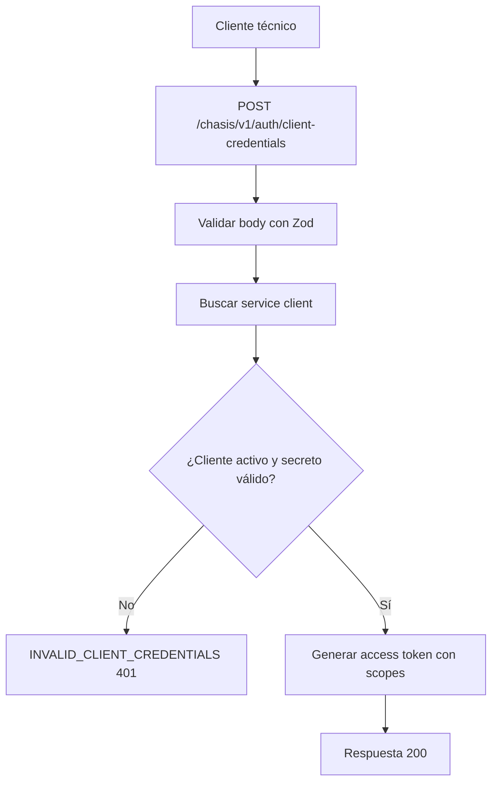

# Caso de uso: Credenciales de cliente

> **Endpoint:** POST `/chasis/v1/auth/client-credentials`  
> **Versión:** v1

## Descripción

Autentica un cliente técnico y emite un token de acceso con sus scopes.

## Detalles del endpoint

| Método | Ruta | Content-Type |
| --- | --- | --- |
| POST | `/chasis/v1/auth/client-credentials` | `application/json` |

## Actores

- **Cliente técnico:** envía su ID y secreto.
- **PostgreSQL/Prisma:** busca el cliente técnico.
- **Servicio JWT:** genera el token.

## Precondiciones y prerrequisitos

- El body debe contener `clientId` y `clientSecret` no vacíos.
- El cliente debe existir, estar activo y tener un secreto coincidente.

## Parámetros de entrada

### Headers

| Nombre | Tipo | Requerido | Descripción |
| --- | --- | --- | --- |
| `Content-Type` | string | Sí | Debe indicar `application/json`. |

### Body

| Campo | Tipo | Requerido | Validación |
| --- | --- | --- | --- |
| `clientId` | string | Sí | Mínimo 1 carácter. |
| `clientSecret` | string | Sí | Mínimo 1 carácter. |

## Flujo principal

1. Se valida el body.
2. Se busca el cliente por `clientId`.
3. Se compara el secreto con bcrypt y se verifica `status`.
4. Se firma un token con `sub`, `client_id` y los scopes persistidos.

## Respuestas

### Éxito (`200`)

```json
{ "token": "<jwt>", "tokenType": "Bearer", "expiresIn": 900 }
```

### Errores

| HTTP | Código | Causa |
| --- | --- | --- |
| 401 | `INVALID_CLIENT_CREDENTIALS` | Cliente inexistente, inactivo o secreto inválido |
| 422 | `VALIDATION_ERROR` | Body inválido |

## Detalles técnicos

- Repositorio: `ServiceClientPrismaRepository`.
- El token de acceso usa la duración configurada en `JWT_ACCESS_EXPIRES_IN`.

## Diagrama de flujo


