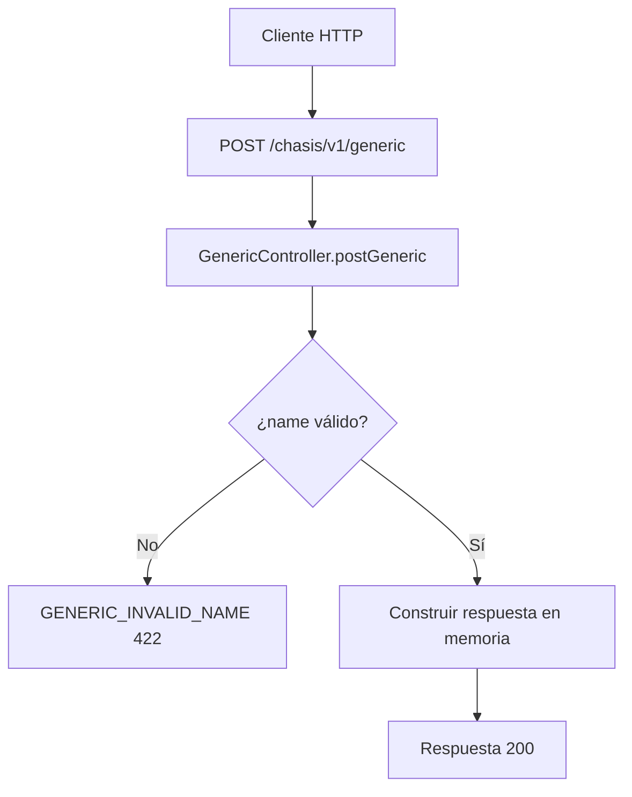

# Caso de uso: Crear generic

> **Endpoint:** POST `/chasis/v1/generic/`  
> **Versión:** v1

## Descripción

Valida parcialmente y devuelve los datos de un objeto genérico. No persiste el registro.

## Detalles del endpoint

| Método | Ruta | Content-Type |
| --- | --- | --- |
| POST | `/chasis/v1/generic/` | `application/json` |

## Actores

- **Cliente HTTP:** envía los datos del objeto.

## Precondiciones y prerrequisitos

- El body debe poder analizarse como JSON.
- No se configura autenticación ni middleware Zod para esta ruta.

## Parámetros de entrada

### Headers

| Nombre | Tipo | Requerido | Descripción |
| --- | --- | --- | --- |
| `Content-Type` | string | Sí | Debe indicar `application/json` para enviar el body JSON. |

### Body

```json
{ "name": "Julian", "lastName": "Arango", "age": 30 }
```

| Campo | Tipo | Requerido | Validación |
| --- | --- | --- | --- |
| `name` | string | Sí, por el caso de uso | No vacío y mínimo 3 caracteres después de `trim` |
| `lastName` | string | No validado en el caso de uso | Sin regla evidenciada |
| `age` | number | No validado en el caso de uso | Sin regla evidenciada |

## Flujo principal

1. El controlador toma `req.body`.
2. `CreateGenericUseCase` valida `name`.
3. Si es válido, devuelve los tres campos recibidos.
4. No se llama a un repositorio.

## Respuestas

### Éxito (`200`)

```json
{ "name": "Julian", "lastName": "Arango", "age": 30 }
```

### Errores

| HTTP | Código | Causa |
| --- | --- | --- |
| 400 | `INVALID_JSON` | Body JSON mal formado |
| 422 | `GENERIC_INVALID_NAME` | Nombre ausente o menor de 3 caracteres |
| 500 | `INTERNAL_SERVER_ERROR` | Error no controlado |

## Reglas específicas

- La operación es una transformación en memoria; el nombre “crear” no implica persistencia en la implementación actual.

## Detalles de implementación

- Controlador: `src/infraestructure/controllers/v1/generic.controller.ts`.
- Caso de uso: `src/application/use-cases/generic/create-generic.usecase.ts`.

## Diagrama de flujo


