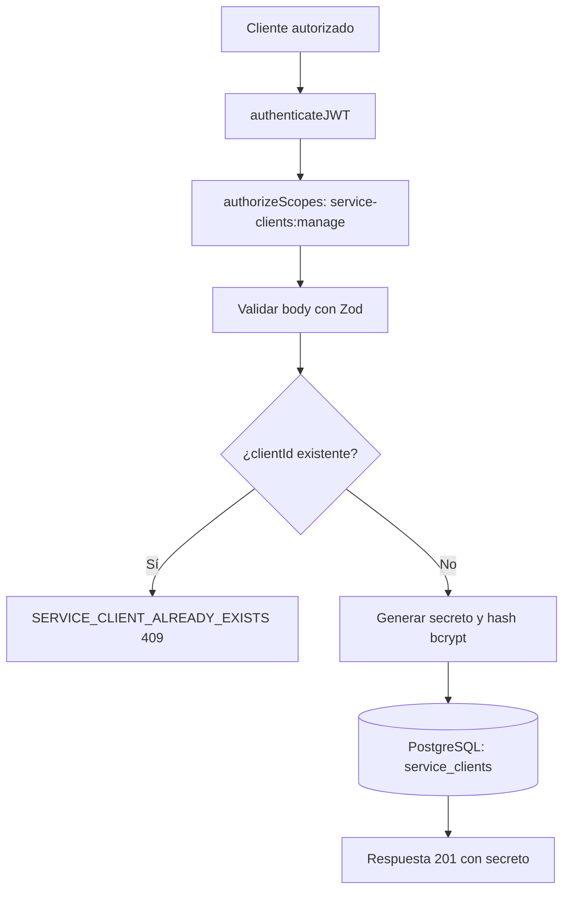

# Caso de uso: Crear cliente de servicio

> **Endpoint:** POST `/chasis/v1/auth/service-clients`  
> **Versión:** v1

## Descripción

Crea un cliente técnico, almacena su secreto como hash y devuelve el secreto en texto plano para su entrega inicial.

## Detalles del endpoint

| Método | Ruta | Content-Type |
| --- | --- | --- |
| POST | `/chasis/v1/auth/service-clients` | `application/json` |

## Actores

- **Administrador autorizado:** requiere el scope `service-clients:manage`.
- **PostgreSQL/Prisma:** persiste el cliente y su hash.

## Precondiciones y prerrequisitos

- JWT de acceso válido con `service-clients:manage`.
- `clientId` no registrado previamente.

## Parámetros de entrada

### Headers

| Nombre | Tipo | Requerido | Descripción |
| --- | --- | --- | --- |
| `Authorization` | string | Sí | `Bearer <token>` con scope `service-clients:manage`. |
| `Content-Type` | string | Sí | Debe indicar `application/json`. |

### Body

| Campo | Tipo | Requerido | Validación |
| --- | --- | --- | --- |
| `clientId` | string | Sí | Entre 3 y 100 caracteres. |
| `scopes` | string[] | Sí | Al menos un elemento y cada string no vacío. |

## Flujo principal

1. Se autentica y autoriza la solicitud.
2. Se valida el body.
3. Se comprueba que no exista el `clientId`.
4. Se genera un secreto aleatorio base64url.
5. Se guarda el hash bcrypt de costo `12`, junto con los scopes.
6. Se devuelve el secreto en texto plano.

## Respuestas

### Éxito (`201`)

```json
{ "clientId": "billing-service", "clientSecret": "<secret>", "scopes": ["generic"] }
```

### Errores

| HTTP | Código | Causa |
| --- | --- | --- |
| 401/403 | Middleware de autenticación/autorización | Token inválido o scope faltante |
| 409 | `SERVICE_CLIENT_ALREADY_EXISTS` | ID duplicado |
| 422 | `VALIDATION_ERROR` | Body inválido |

## Reglas específicas

- El secreto en texto plano solo aparece en la respuesta de creación; la persistencia usa `client_secret_hash`.

## Diagrama de flujo


