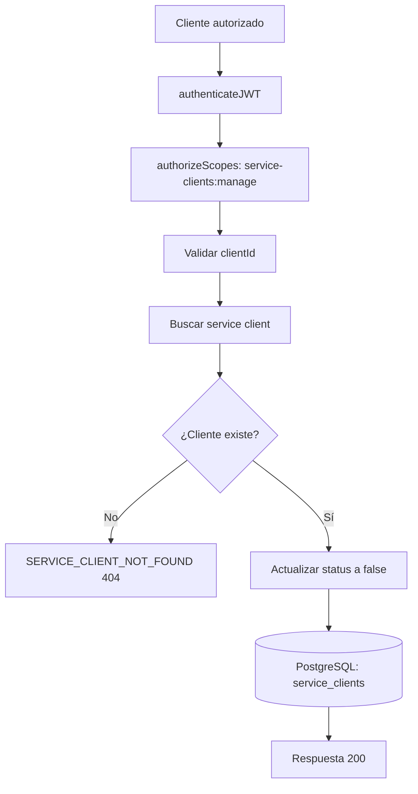

# Caso de uso: Deshabilitar cliente de servicio

> **Endpoint:** PATCH `/chasis/v1/auth/service-clients/:clientId/disable`  
> **Versión:** v1

## Descripción

Marca un cliente técnico existente como inactivo.

## Detalles del endpoint

| Método | Ruta | Content-Type |
| --- | --- | --- |
| PATCH | `/chasis/v1/auth/service-clients/:clientId/disable` | No aplica |

## Actores

- **Administrador autorizado:** requiere `service-clients:manage`.
- **PostgreSQL/Prisma:** actualiza el estado del cliente.

## Precondiciones y prerrequisitos

- JWT de acceso válido con el scope requerido.
- `clientId` no vacío y existente.

## Parámetros de entrada

### Headers

| Nombre | Tipo | Requerido | Descripción |
| --- | --- | --- | --- |
| `Authorization` | string | Sí | `Bearer <token>` con scope `service-clients:manage`. |

### Parámetro de ruta

| Nombre | Tipo | Requerido | Validación |
| --- | --- | --- | --- |
| `clientId` | string | Sí | Mínimo 1 carácter. |

## Flujo principal

1. Se autentica y autoriza la solicitud.
2. Se valida `clientId`.
3. Se comprueba que el cliente exista.
4. Se actualiza `status` a `false`.
5. Se devuelve el estado resultante.

## Respuestas

### Éxito (`200`)

```json
{ "clientId": "billing-service", "status": false }
```

### Errores

| HTTP | Código | Causa |
| --- | --- | --- |
| 404 | `SERVICE_CLIENT_NOT_FOUND` | Cliente inexistente |
| 422 | `VALIDATION_ERROR` | Parámetro inválido |

## Reglas específicas

- La operación actualiza el estado a `false`; no elimina el registro ni rota su secreto.

## Diagrama de flujo


