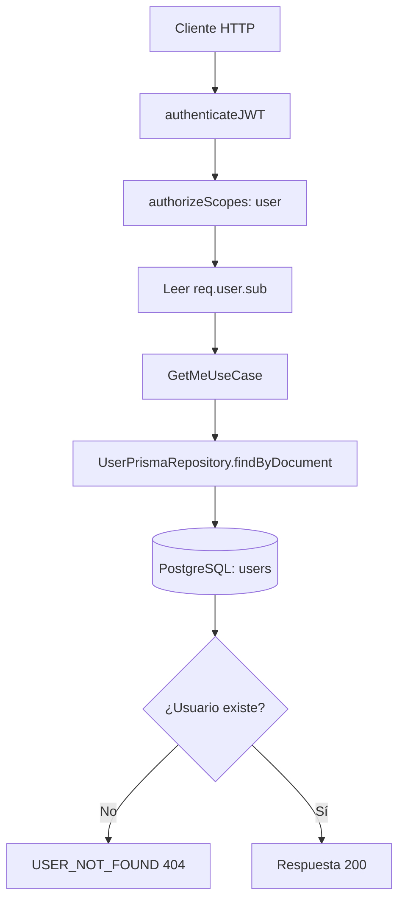

# Caso de uso: Consultar usuario actual

> **Endpoint:** GET `/chasis/v1/users/me`  
> **Versión:** v1

## Descripción

Obtiene los datos públicos del usuario representado por el JWT de acceso.

## Detalles del endpoint

| Método | Ruta | Content-Type |
| --- | --- | --- |
| GET | `/chasis/v1/users/me` | No aplica |

## Actores

- **Usuario autenticado:** presenta el JWT.
- **PostgreSQL/Prisma:** busca el usuario por número de documento.

## Precondiciones y prerrequisitos

- Debe existir `Authorization: Bearer <token>`.
- El token debe ser de acceso y contener el scope `user`.
- El claim `sub` se interpreta como número de documento.

## Parámetros de entrada

### Headers

| Nombre | Tipo | Requerido | Descripción |
| --- | --- | --- | --- |
| `Authorization` | string | Sí | `Bearer <token>` con JWT de acceso y scope `user`. |

No recibe body, path params ni query.

## Flujo principal

1. `authenticateJWT` verifica el JWT y adjunta sus claims en `req.user`.
2. `authorizeScopes(["user"])` valida el scope.
3. El controlador lee `req.user.sub`.
4. `GetMeUseCase` busca el usuario y devuelve sus datos públicos.

## Respuestas

### Éxito (`200`)

```json
{ "documentType": "CC", "documentNumber": "1037630472", "fullName": "Julian Arango", "email": "julian@email.com", "phone": "3117468187" }
```

### Errores

| HTTP | Código | Causa |
| --- | --- | --- |
| 401 | `UNAUTHORIZED` o `INVALID_TOKEN` | Falta o invalidez del JWT |
| 403 | `FORBIDDEN` | No hay scopes |
| 404 | `USER_NOT_FOUND` | No existe el usuario del claim `sub` |

## Detalles técnicos

- Caso de uso: `src/application/use-cases/users/get-me-user.usecase.ts`.
- Repositorio activo: `UserPrismaRepository`.

## Diagrama de flujo


