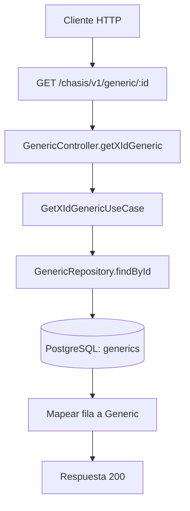

# Caso de uso: Consultar generic por ID

> **Endpoint:** GET `/chasis/v1/generic/:id`  
> **Versión:** v1

## Descripción

Busca un registro `generic` por ID usando el repositorio legacy basado en `pg`.

## Detalles del endpoint

| Método | Ruta | Content-Type |
| --- | --- | --- |
| GET | `/chasis/v1/generic/:id` | No aplica |

## Actores

- **Cliente HTTP:** solicita un registro por su identificador.
- **PostgreSQL:** almacena y consulta la tabla `generics` mediante el pool `pg`.

## Precondiciones y prerrequisitos

- Debe enviarse un valor de ruta `id`.
- La conexión `DATABASE_URL` debe estar disponible para el pool de PostgreSQL.

## Parámetros de entrada

### Parámetros de ruta

| Nombre | Tipo | Requerido | Descripción |
| --- | --- | --- | --- |
| `id` | string | Sí | Identificador usado en `WHERE id = $1`. |

No hay validación de headers, query ni body.

## Flujo principal

1. El controlador lee `req.params.id`.
2. `GetXIdGenericUseCase` llama a `GenericRepository.findById`.
3. El repositorio ejecuta SQL parametrizado y mapea la fila a `Generic`.
4. El controlador devuelve los campos del resultado.

## Respuestas

### Éxito (`200`)

```json
{ "name": "Julian", "lastName": "Arango", "age": 30 }
```

Si no existe la fila, el controlador también responde `200` y puede enviar campos indefinidos; no se implementa `404`.

## Reglas específicas y excepciones

- El SQL se parametriza con `$1` para el ID.
- El repositorio usa `pg`, no Prisma.

## Detalles técnicos

- Caso de uso: `src/application/use-cases/generic/getxid-generic.usecase.ts`.
- Repositorio: `src/infraestructure/database/repositories/generic.repository.ts`.

## Diagrama de flujo


