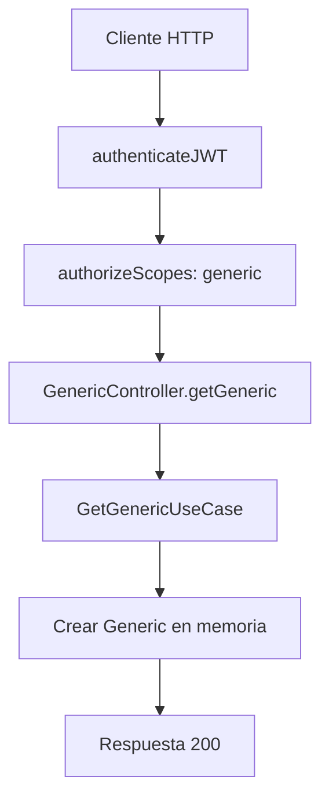

# Caso de uso: Consultar generic

> **Endpoint:** GET `/chasis/v1/generic/`  
> **Versión:** v1

## Descripción

Devuelve un objeto `Generic` de ejemplo mantenido en memoria.

## Detalles del endpoint

| Método | Ruta | Content-Type |
| --- | --- | --- |
| GET | `/chasis/v1/generic/` | No aplica |

## Actores

- **Cliente autenticado:** consume el recurso con un JWT y scope permitido.

## Precondiciones y prerrequisitos

- Debe existir un header `Authorization: Bearer <token>` válido.
- El token debe incluir el scope `generic`.

## Parámetros de entrada

### Headers

| Nombre | Tipo | Requerido | Descripción |
| --- | --- | --- | --- |
| `Authorization` | string | Sí | `Bearer <token>` con JWT de acceso y scope `generic`. |

No recibe body, parámetros de ruta ni query.

## Flujo principal

1. `authenticateJWT` verifica el token de acceso.
2. `authorizeScopes(["generic"])` valida el scope.
3. El controlador ejecuta `GetGenericUseCase`.
4. El caso de uso crea `Generic("Julian", "Arango", 30)` y lo devuelve.

## Respuestas

### Éxito (`200`)

```json
{ "name": "Julian", "lastName": "Arango", "age": 30 }
```

### Errores

Los middlewares pueden devolver `401` por token faltante/inválido, `403` por ausencia de scopes o `401` por permisos insuficientes.

## Reglas específicas

- El resultado es fijo y no se consulta ningún repositorio ni base de datos.

## Detalles de implementación

- Router: `src/infraestructure/http/routes/v1/generic.routes.ts`.
- Caso de uso: `src/application/use-cases/generic/get-generic.usecase.ts`.

## Diagrama de flujo


