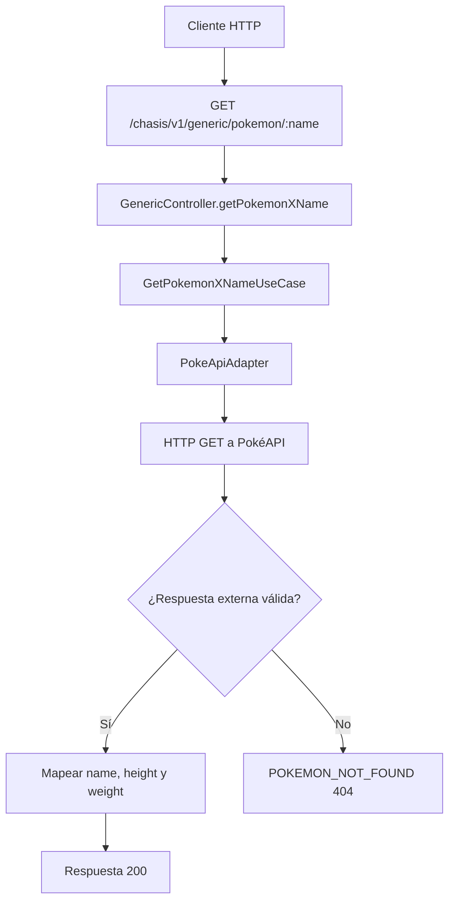

# Caso de uso: Consultar Pokémon por nombre

> **Endpoint:** GET `/chasis/v1/generic/pokemon/:name`  
> **Versión:** v1

## Descripción

Consulta PokéAPI y devuelve información básica del Pokémon solicitado.

## Detalles del endpoint

| Método | Ruta | Content-Type |
| --- | --- | --- |
| GET | `/chasis/v1/generic/pokemon/:name` | No aplica |

## Actores

- **Cliente HTTP:** solicita un Pokémon.
- **PokéAPI:** sistema externo consultado por el adaptador.

## Precondiciones y prerrequisitos

- Debe enviarse el parámetro `name`.
- La aplicación debe poder acceder a `https://pokeapi.co`.

## Parámetros de entrada

### Parámetros de ruta

| Nombre | Tipo | Requerido | Descripción |
| --- | --- | --- | --- |
| `name` | string | Sí | Nombre enviado a PokéAPI. |

No se configuran autenticación, scopes ni validación Zod para esta ruta.

## Flujo principal

1. El controlador recibe `name`.
2. `GetPokemonXNameUseCase` invoca `PokeApiAdapter`.
3. El adaptador llama `GET https://pokeapi.co/api/v2/pokemon/:name` mediante Axios con timeout de 4 segundos.
4. La respuesta se transforma a `name`, `height` y `weight`.
5. El caso de uso registra el resultado y lo devuelve.

## Respuestas

### Éxito (`200`)

```json
{ "name": "pikachu", "height": 4, "weight": 60 }
```

El ejemplo representa la estructura; los valores dependen de la respuesta externa.

### Errores

| HTTP | Código | Causa |
| --- | --- | --- |
| 404 | `POKEMON_NOT_FOUND` | Cualquier error del adaptador, incluido un 404 externo |

## Reglas específicas

- No hay reintentos ni mapeo diferenciado para errores distintos de 404.

## Integraciones y detalles técnicos

- Adaptador: `src/infraestructure/adapters/poke-api.adapter.ts`.
- Cliente HTTP: `src/infraestructure/http/http-client.ts`.
- El proveedor no requiere autenticación según la implementación disponible.

## Diagrama de flujo


