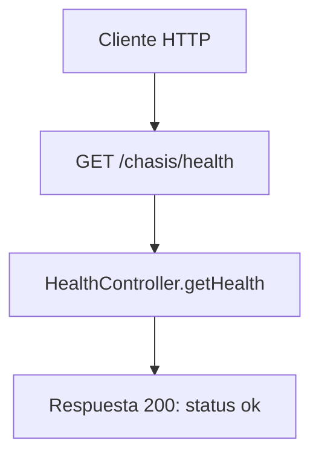

# Caso de uso: Verificación de salud

> **Endpoint:** GET `/chasis/health/`  
> **Versión:** sin versión

## Descripción

Permite comprobar que la API responde.

## Detalles del endpoint

| Método | Ruta | Content-Type |
| --- | --- | --- |
| GET | `/chasis/health/` | No aplica |

## Actores

- **Cliente HTTP:** solicita el estado de la API.

## Precondiciones y prerrequisitos

- No se requiere autenticación ni conexión a la base de datos para ejecutar el controlador.

## Parámetros de entrada

No recibe headers, parámetros de ruta, query ni body documentados.

## Flujo principal

1. El router resuelve `HealthController`.
2. El controlador devuelve una respuesta JSON literal.
3. El `HealthService` inyectado no se utiliza en este flujo.

## Respuestas

### Éxito (`200`)

```json
{ "status": "ok", "service": "chasis-express-ts" }
```

### Errores

No hay errores específicos definidos por este caso de uso. Los errores inesperados se manejan globalmente como `500/INTERNAL_SERVER_ERROR`.

## Reglas específicas

- La respuesta no representa una comprobación activa de PostgreSQL; el controlador devuelve valores constantes.

## Detalles de implementación

- Router: `src/infraestructure/http/routes/health.routes.ts`.
- Controlador: `src/infraestructure/controllers/health.controller.ts`.
- Servicio registrado pero no invocado: `src/infraestructure/services/health.service.ts`.

## Diagrama de flujo


