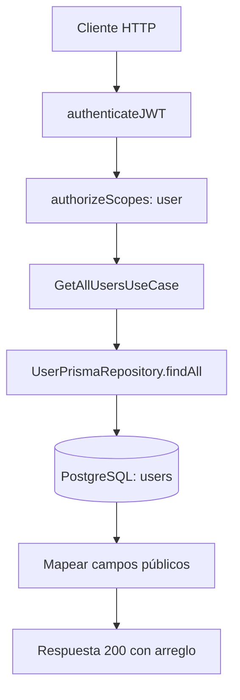

# Caso de uso: Listar usuarios

> **Endpoint:** GET `/chasis/v1/users/`  
> **Versión:** v1

## Descripción

Consulta todos los usuarios y devuelve únicamente los campos públicos definidos por el caso de uso.

## Detalles del endpoint

| Método | Ruta | Content-Type |
| --- | --- | --- |
| GET | `/chasis/v1/users/` | No aplica |

## Actores

- **Usuario autenticado:** consume el listado con scope `user`.
- **PostgreSQL/Prisma:** obtiene los usuarios.

## Precondiciones y prerrequisitos

- Se requiere JWT de acceso válido.
- El JWT debe incluir el scope `user`.

## Parámetros de entrada

### Headers

| Nombre | Tipo | Requerido | Descripción |
| --- | --- | --- | --- |
| `Authorization` | string | Sí | `Bearer <token>` con JWT de acceso y scope `user`. |

No recibe body, parámetros de ruta ni query.

## Flujo principal

1. Se autentica la solicitud y se verifica el scope.
2. `GetAllUsersUseCase` llama a `UserPrismaRepository.findAll`.
3. Cada usuario se transforma a documento, nombre, email, teléfono, `hasPin` y `status`.
4. El controlador devuelve el arreglo.

## Respuestas

### Éxito (`200`)

```json
[
  {
    "documentType": "CC",
    "documentNumber": "1037630472",
    "fullName": "Julian Arango",
    "email": "julian@email.com",
    "phone": "3117468187",
    "hasPin": false,
    "status": true
  }
]
```

### Errores

La autenticación y autorización usan los errores compartidos. Un error inesperado del repositorio devuelve `500/INTERNAL_SERVER_ERROR`.

## Inconsistencia conocida

El schema OpenAPI registrado es un objeto, mientras que el controlador devuelve un arreglo. Esta documentación sigue el comportamiento del controlador.

## Diagrama de flujo


