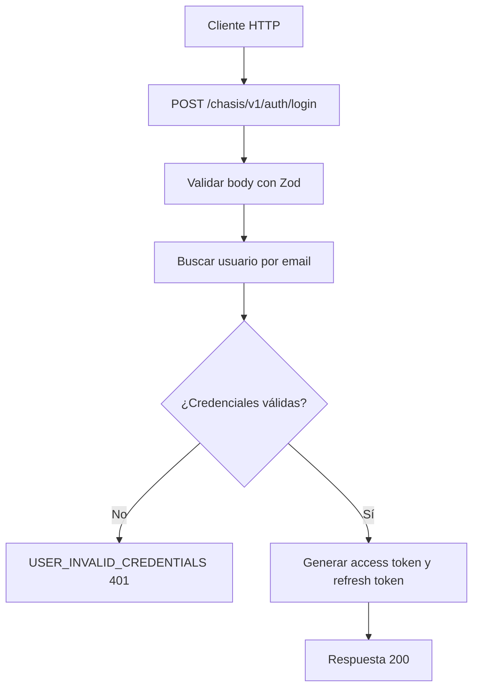

# Caso de uso: Iniciar sesión

> **Endpoint:** POST `/chasis/v1/auth/login`  
> **Versión:** v1

## Descripción

Valida las credenciales de un usuario y emite un token de acceso y uno de renovación.

## Detalles del endpoint

| Método | Ruta | Content-Type |
| --- | --- | --- |
| POST | `/chasis/v1/auth/login` | `application/json` |

## Actores

- **Usuario/cliente HTTP:** envía email y contraseña.
- **PostgreSQL/Prisma:** busca el usuario.
- **Servicio JWT:** firma los tokens.

## Precondiciones y prerrequisitos

- El body debe contener un email válido y una contraseña de texto.
- El usuario debe existir y la contraseña debe coincidir con el hash almacenado.

## Parámetros de entrada

### Headers

| Nombre | Tipo | Requerido | Descripción |
| --- | --- | --- | --- |
| `Content-Type` | string | Sí | Debe indicar `application/json`. |

### Body

| Campo | Tipo | Requerido | Validación |
| --- | --- | --- | --- |
| `email` | string | Sí | Formato email. |
| `password` | string | Sí | Cadena no vacía según el DTO; el schema no define mínimo. |

## Flujo principal

1. Se valida el body con Zod.
2. Se busca el usuario por email.
3. Se compara la contraseña con bcrypt.
4. Se firma el access token con scope `user` y `sub` igual al número de documento.
5. Se firma el refresh token y se devuelve el par.

## Respuestas

### Éxito (`200`)

```json
{ "token": "<jwt>", "refreshToken": "<jwt>", "tokenType": "Bearer", "expiresIn": 900, "refreshExpiresIn": 2592000 }
```

Los valores de expiración dependen de `JWT_ACCESS_EXPIRES_IN` y `JWT_REFRESH_EXPIRES_IN`.

### Errores

| HTTP | Código | Causa |
| --- | --- | --- |
| 401 | `USER_INVALID_CREDENTIALS` | Email inexistente o contraseña inválida |
| 422 | `VALIDATION_ERROR` | Body inválido |

## Reglas específicas

- El token de acceso se firma con HS256 y contiene el scope `user`.
- El secreto JWT se toma de `JWT_SECRET`, cuyo fallback actual es `secret`.

## Diagrama de flujo


