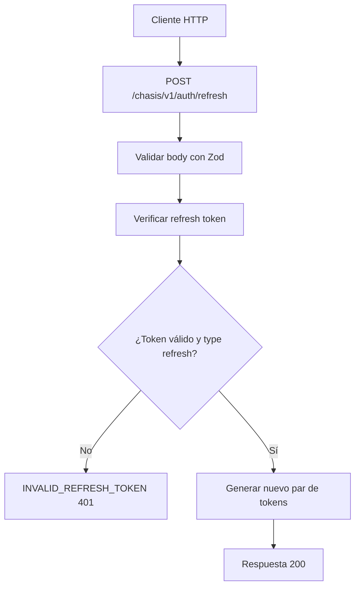

# Caso de uso: Renovar tokens

> **Endpoint:** POST `/chasis/v1/auth/refresh`  
> **Versión:** v1

## Descripción

Verifica un refresh token y emite un nuevo par de tokens.

## Detalles del endpoint

| Método | Ruta | Content-Type |
| --- | --- | --- |
| POST | `/chasis/v1/auth/refresh` | `application/json` |

## Actores

- **Cliente HTTP:** envía el refresh token.
- **Servicio JWT:** verifica y vuelve a firmar los tokens.

## Precondiciones y prerrequisitos

- El body debe incluir `refreshToken` no vacío.
- El token debe tener firma válida, algoritmo HS256 y `type: "refresh"`.

## Parámetros de entrada

### Headers

| Nombre | Tipo | Requerido | Descripción |
| --- | --- | --- | --- |
| `Content-Type` | string | Sí | Debe indicar `application/json`. |

### Body

| Campo | Tipo | Requerido | Validación |
| --- | --- | --- | --- |
| `refreshToken` | string | Sí | Mínimo 1 carácter. |

## Flujo principal

1. Se valida el body.
2. Se verifica el refresh token.
3. Se conservan `sub`, `email`, `username`, `client_id` y `scopes` cuando existen.
4. Se genera un nuevo access token y un nuevo refresh token.

## Respuestas

### Éxito (`200`)

Devuelve `{ token, refreshToken, tokenType: "Bearer", expiresIn, refreshExpiresIn }`.

### Errores

| HTTP | Código | Causa |
| --- | --- | --- |
| 401 | `INVALID_REFRESH_TOKEN` | Token inválido, expirado o de tipo incorrecto |
| 422 | `VALIDATION_ERROR` | Body inválido |

## Detalles de implementación

- Caso de uso: `src/application/use-cases/users/refresh-token.usecase.ts`.
- La ruta no requiere bearer token; la credencial es el refresh token del body.

## Diagrama de flujo

