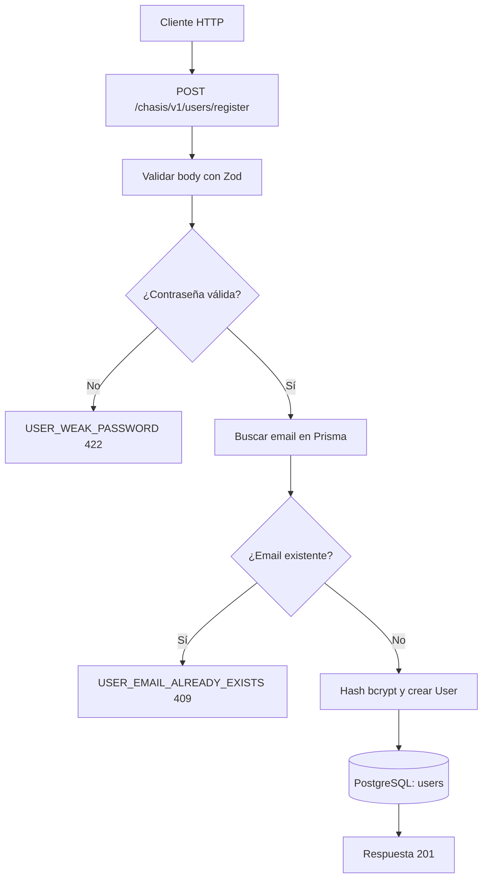

# Caso de uso: Registrar usuario

> **Endpoint:** POST `/chasis/v1/users/register`  
> **Versión:** v1

## Descripción

Registra un usuario nuevo, protege su contraseña con bcrypt y lo guarda mediante Prisma.

## Detalles del endpoint

| Método | Ruta | Content-Type |
| --- | --- | --- |
| POST | `/chasis/v1/users/register` | `application/json` |

## Actores

- **Cliente HTTP:** envía los datos de registro.
- **PostgreSQL/Prisma:** persiste el usuario.

## Precondiciones y prerrequisitos

- El body debe cumplir el schema Zod de registro.
- El email no debe existir previamente.

## Parámetros de entrada

### Headers

| Nombre | Tipo | Requerido | Descripción |
| --- | --- | --- | --- |
| `Content-Type` | string | Sí | Debe indicar `application/json`. |

### Body

| Campo | Tipo | Requerido | Validación |
| --- | --- | --- | --- |
| `documentType` | string | Sí | Mínimo 2 caracteres en Zod; la entidad admite `CC`, `CE`, `NIT`, `PT`. |
| `documentNumber` | string | Sí | Mínimo 5 caracteres. |
| `fullName` | string | Sí | Mínimo 3 caracteres. |
| `email` | string | Sí | Formato email. |
| `phone` | string | Sí en el schema | Mínimo 7 caracteres. |
| `password` | string | Sí | Además, el caso de uso exige mínimo 8 caracteres, mayúscula y número. |

## Flujo principal

1. `validate` valida el body y reemplaza `req.body` por los datos parseados.
2. `RegisterUserUseCase` valida la fortaleza de la contraseña.
3. Busca un usuario existente por email.
4. Genera el hash bcrypt con costo `10`.
5. Crea el usuario con `hasPin=false` y `status=true`.
6. `UserPrismaRepository` guarda el registro y se devuelve el resultado público.

## Respuestas

### Éxito (`201`)

```json
{ "id": "1037630472", "email": "julian@email.com", "fullName": "Julian Arango", "message": "User registered successfully" }
```

### Errores

| HTTP | Código | Causa |
| --- | --- | --- |
| 409 | `USER_EMAIL_ALREADY_EXISTS` | Email ya registrado |
| 422 | `VALIDATION_ERROR` | Body inválido |
| 422 | `USER_WEAK_PASSWORD` | Contraseña sin mayúscula, número o longitud requerida |

## Detalles técnicos

- Repositorio: `src/infraestructure/database/repositories/user-prisma.repository.ts`.
- El `id` de respuesta es el número de documento, no el UUID interno de Prisma.

## Diagrama de flujo


