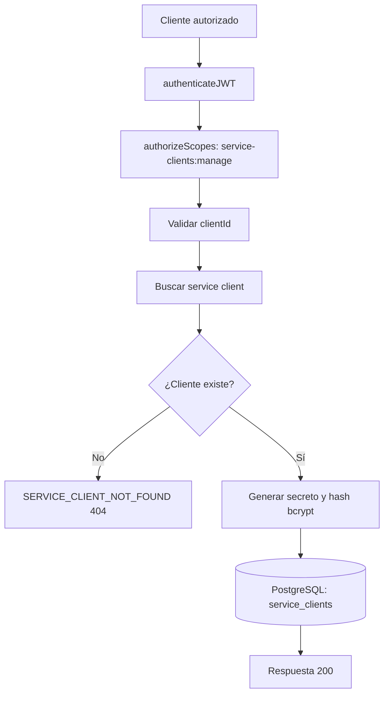

# Caso de uso: Rotar secreto de cliente

> **Endpoint:** POST `/chasis/v1/auth/service-clients/:clientId/rotate-secret`  
> **Versión:** v1

## Descripción

Genera y almacena un nuevo secreto para un cliente técnico existente.

## Detalles del endpoint

| Método | Ruta | Content-Type |
| --- | --- | --- |
| POST | `/chasis/v1/auth/service-clients/:clientId/rotate-secret` | No aplica |

## Actores

- **Administrador autorizado:** requiere `service-clients:manage`.
- **PostgreSQL/Prisma:** actualiza el hash del secreto.

## Precondiciones y prerrequisitos

- JWT de acceso válido con el scope requerido.
- `clientId` no vacío y existente.

## Parámetros de entrada

### Headers

| Nombre | Tipo | Requerido | Descripción |
| --- | --- | --- | --- |
| `Authorization` | string | Sí | `Bearer <token>` con scope `service-clients:manage`. |

### Parámetro de ruta

| Nombre | Tipo | Requerido | Validación |
| --- | --- | --- | --- |
| `clientId` | string | Sí | Mínimo 1 carácter. |

## Flujo principal

1. Se autentica y autoriza la solicitud.
2. Se valida `clientId`.
3. Se comprueba la existencia del cliente.
4. Se genera un nuevo secreto y se guarda su hash bcrypt de costo `12`.
5. Se devuelve el nuevo secreto.

## Respuestas

### Éxito (`200`)

```json
{ "clientId": "billing-service", "clientSecret": "<new-secret>" }
```

### Errores

| HTTP | Código | Causa |
| --- | --- | --- |
| 404 | `SERVICE_CLIENT_NOT_FOUND` | Cliente inexistente |
| 422 | `VALIDATION_ERROR` | Parámetro inválido |

## Reglas específicas

- El secreto anterior no se devuelve y el caso de uso no implementa historial de secretos.

## Diagrama de flujo


