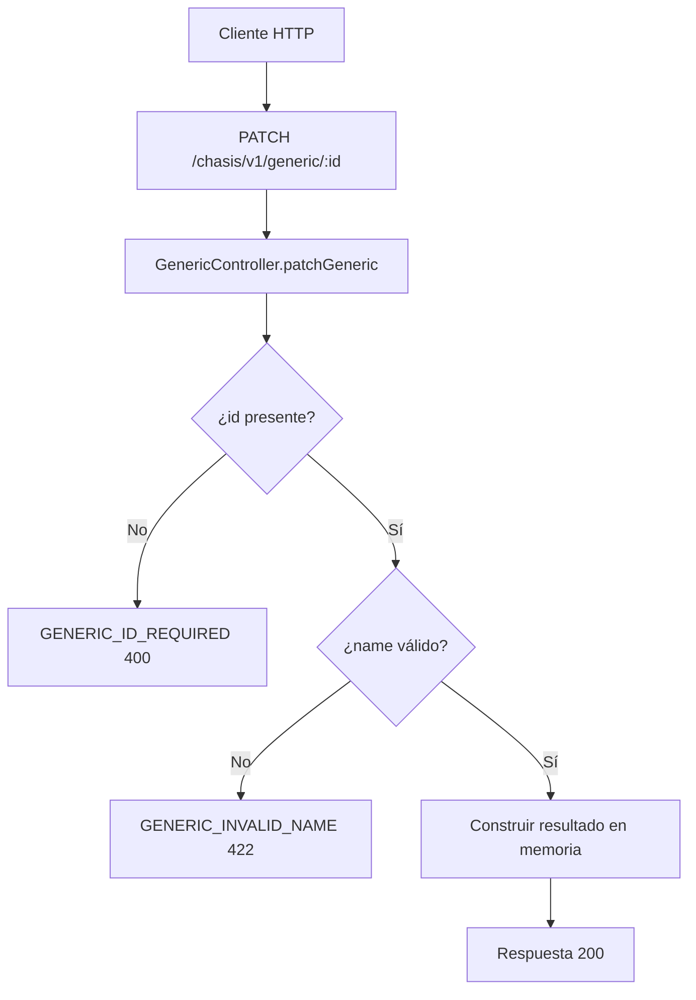

# Caso de uso: Actualizar generic

> **Endpoint:** PATCH `/chasis/v1/generic/:id`  
> **Versión:** v1

## Descripción

Valida y devuelve una propuesta de actualización de un objeto generic. No modifica la base de datos.

## Detalles del endpoint

| Método | Ruta | Content-Type |
| --- | --- | --- |
| PATCH | `/chasis/v1/generic/:id` | `application/json` |

## Actores

- **Cliente HTTP:** envía el ID y los nuevos datos.

## Precondiciones y prerrequisitos

- Debe existir un `id` de ruta no vacío.
- El body debe incluir un `name` de al menos 3 caracteres después de `trim`.
- No se configuran autenticación ni validación Zod.

## Parámetros de entrada

### Headers

| Nombre | Tipo | Requerido | Descripción |
| --- | --- | --- | --- |
| `Content-Type` | string | Sí | Debe indicar `application/json` para enviar el body JSON. |

### Parámetros de ruta

| Nombre | Tipo | Requerido | Descripción |
| --- | --- | --- | --- |
| `id` | string | Sí | Identificador que se devuelve en el resultado. |

### Body

| Campo | Tipo | Regla evidenciada |
| --- | --- | --- |
| `name` | string | Requerido y mínimo 3 caracteres después de `trim`. |
| `lastName` | string | Se devuelve sin validación específica. |
| `age` | number | Se devuelve sin validación específica. |

## Flujo principal

1. El caso de uso registra la solicitud.
2. Valida `id` y `name`.
3. Construye el resultado con `id`, `name`, `lastName` y `age`.
4. El controlador envuelve el resultado en `message` y `result`.

## Respuestas

### Éxito (`200`)

```json
{ "message": "PATCH request received", "result": { "name": "Julian", "lastName": "Arango", "age": 30 } }
```

### Errores

| HTTP | Código | Causa |
| --- | --- | --- |
| 400 | `GENERIC_ID_REQUIRED` | ID vacío |
| 422 | `GENERIC_INVALID_NAME` | Nombre ausente o menor de 3 caracteres |

## Detalles de implementación

- Caso de uso: `src/application/use-cases/generic/update-generic.usecase.ts`.
- No hay llamada a repositorio ni persistencia.

## Diagrama de flujo


